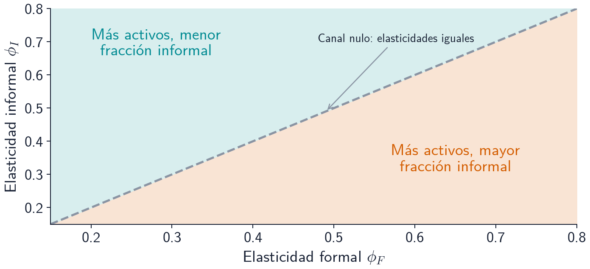

<h1 align="center">Ahorro, flexibilidad de horas e informalidad en el Perú</h1>

  <strong>John Svante Barraza Ratachi</strong> 
  Profesor Alexander Quispe, Universidad del Pacífico 
  AI and Economic Modeling, Track B, paper final, 26 de noviembre de 2026

  <strong><a href="paper/paper.pdf">Leer el paper final</a></strong> &nbsp;|&nbsp; <a href="paper/paper.tex">LaTeX</a> &nbsp;|&nbsp; <a href="slides/final.pdf">Presentación final</a> &nbsp;|&nbsp; <a href="proposal/proposal.pdf">Propuesta</a> &nbsp;|&nbsp; <a href="slides/topic.pdf">Slides de tema</a>

  <a href="hand/README.md">Derivaciones a mano</a> &nbsp;|&nbsp; <a href="lean/">Lean</a> &nbsp;|&nbsp; <a href="code/verify.py">Verificador</a> &nbsp;|&nbsp; <a href="prompts.md">Prompts crudos</a> &nbsp;|&nbsp; <a href="docs/entrega-paper.md">Estado de requisitos</a>

---

> **Pregunta.** ¿Cuándo influye la riqueza en el reparto de horas entre formal e informal, a igual productividad?

## Modelo y resultado condicional

**Modelo macroeconómico.** Hogares con activos y productividad heterogéneos eligen ahorro, consumo y horas. Dos firmas demandan capital y trabajo; la distribución estacionaria agrega esas decisiones. La tasa de interés y el precio informal deben cerrar activos y bienes. El baseline es Aiyagari; se estudia un modelo de dos sectores y su sensibilidad de elasticidades.

**Resultado condicional.** Con retornos positivos, costos laborales separables y parámetros positivos, activos y horas interiores, tiempo holgado y valor marginal de activos positivo y diferenciable, la derivada de la fracción informal es `sI(1−sI)(phiI−phiF)Vaa/Va`. Si `Vaa<0`, más activos reducen esa fracción cuando `phiI>phiF`; con elasticidad común el canal directo se cancela. Una relación agregada también depende de la distribución de productividad.

## Materiales y estado

| Material | Estado y enlace |
|---|---|
| Presentación final | [PDF](slides/final.pdf), [LaTeX](slides/final.tex): modelo, proposición, simulaciones, Lean e IA, con anexos de consulta |
| Manuscrito | [PDF](paper/paper.pdf), [LaTeX](paper/paper.tex), [bibliografía](paper/references.bib): 13 páginas de cuerpo; GE y contrastes de tiempo incorporados; derivaciones manuscritas en [hand/](hand/README.md) |
| Simulaciones | [Verificador](code/verify.py): PE, D73 y 23 GE guardados. [Auditoría MATLAB del26nov](docs/concavidad-equilibrio.md): curvatura negativa y mercados verificados; figura adicional y límites teóricos |
| Lean propio | [Estado y recibos](docs/estado-lean.md): carpeta oficial íntegra, proposición probada y cierre validado; revisión humana pendiente. Prototipo preservado aparte |
| Derivación a mano | [Hojas y observaciones](hand/README.md): hoja original ([errata](hand/errata-01.md)) y continuación manuscrita a–g: horas, Proposición 1, consumo, ambas firmas, hogares/gobierno y equilibrio general ([observaciones](hand/errata-02.md)) |
| Primera entrega | [Propuesta](proposal/proposal.pdf), [tema](slides/topic.pdf), conservados |
| Colaboración con IA | [Registro](prompts.md), con enlace a la versión cruda; veredictos y límites en el paper; [veredictos del autor](docs/veredictos-autor.md) |

**Reproducir:** instalar `code/requirements.txt` y ejecutar `python code/verify.py`. Compilar desde `paper/` con `pdflatex paper.tex`, `bibtex paper`, dos pasadas de `pdflatex`; desde `slides/`, dos pasadas de `pdflatex final.tex`. Lean tiene instrucciones separadas en su README.

Personas/gasto y horas/activos son medidas distintas. Los GE son estacionarios, sin IRF ni interpretación causal. Las elasticidades son una sensibilidad ilustrativa; [evidencia](docs/evidencia-elasticidades.md). La precisión por refinamiento y los teoremas globales de concavidad/existencia siguen abiertos.

Entrega completa: **26nov, 22:00 Lima**, según el [issue #7](https://github.com/alexanderquispe/AI-Econ-Modeling/issues/7). [Revisión de todos los requisitos](docs/revision-requisitos-final.md). Lean cerró por [PR #17](https://github.com/johnbarraza/ai-project/pull/17), sobre la [fuente matemática 6777134](https://github.com/johnbarraza/ai-project/blob/6777134ba22670ebd53b65d21a48d719c09b3fbd/paper/paper.pdf). El fallo del wrapper adicional y los pendientes personales están documentados.
