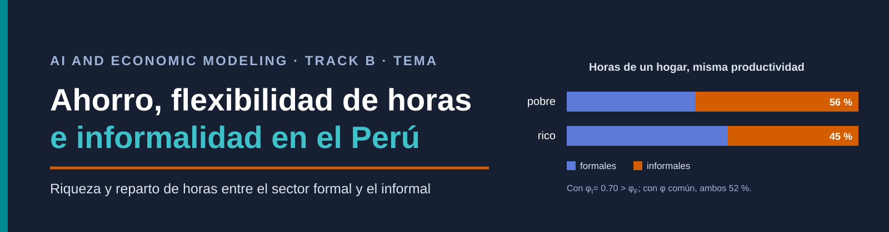
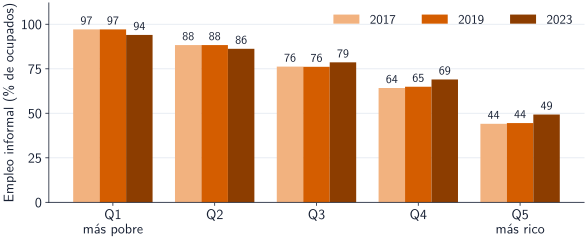
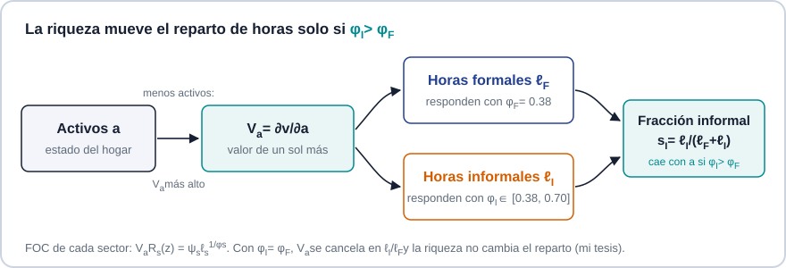
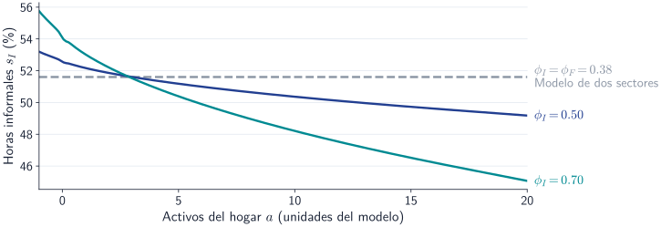

<p align="center">
  
</p>

<p align="center">
  <a href="proposal/proposal.pdf"></a>
  <a href="slides/topic.pdf"></a>
  <a href="code/README.md"></a>
</p>

<p align="center">
  <a href="https://github.com/johnbarraza/ai-project/actions/workflows/build.yml"></a>
  
  
  
  
</p>

<p align="center">
  <strong>John Svante Barraza Ratachi</strong><br>
  Profesor Alexander Quispe · Universidad del Pacífico<br>
  <sub>AI and Economic Modeling · Track B: modelo económico de este trabajo · Presentación de tema · octubre de 2026</sub>
</p>

---

> **Pregunta** · ¿Cuándo influye la riqueza en el reparto de horas entre formal e informal, para una misma productividad?

<p align="center">
  
</p>

*Empleo informal por quintil de gasto per cápita (ENAHO): en 2023, 94 % en el quintil más pobre y 49 % en el más rico. El modelo de dos sectores genera una brecha de solo 4.4 puntos entre el quintil de riqueza más bajo y el más alto.*

## 01 · Modelo

- **Baseline:** Aiyagari (1994) en tiempo continuo (Achdou et al., 2022). Hogares que ahorran por precaución, una firma y un bien; $`r`$ cierra el mercado de activos.
- **Supuesto que cambio (modelo de dos sectores):** dos sectores con horas endógenas. El hogar, con activos $`a`$ y productividad exógena $`z`$, elige consumo y horas formales $`\ell_F`$ e informales $`\ell_I`$. Hay dos firmas (la informal con rendimientos decrecientes) y dos bienes, con precios $`r`$ y $`p_I`$. La barrera por hora formal $`\kappa(z)`$ y la prima de deuda $`\chi(z)`$ caen con $`z`$.
- **Sensibilidad:** horas informales más flexibles, $`\phi_I>\phi_F`$. En el modelo de dos sectores, $`\phi_F=\phi_I=0.38`$.

```math
\max\ \mathbb E_0\int_0^\infty e^{-\rho t}\Big[\ln C-\sum_{s\in\{F,I\}}\frac{\psi_s\ell_s^{1+1/\phi_s}}{1+1/\phi_s}\Big]dt
\quad\text{s.a.}\quad
\dot a=R_F(z)\ell_F+R_I(z)\ell_I+ra-\chi(z)\max(-a,0)+T-c_F-p_Ic_I
```

con $`a\ge\underline a`$ y $`\ell_F+\ell_I\le\bar H`$.

<p align="center">
  
</p>

## 02 · Resultado esperado

De la HJB, con solución interior, la FOC de cada sector iguala el beneficio y el costo de una hora más, y al dividirlas:

```math
V_aR_s(z)=\psi_s\ell_s^{1/\phi_s}
\quad\Longrightarrow\quad
\frac{\partial\ln(\ell_I/\ell_F)}{\partial\ln V_a}=\phi_I-\phi_F,
\qquad
\frac{\partial s_I}{\partial V_a}=s_I(1-s_I)\,\frac{\phi_I-\phi_F}{V_a}.
```

**Conjetura.** Si (i) la solución es interior, $`\ell_F+\ell_I<\bar H`$; (ii) $`R_F(z),R_I(z)>0`$; y (iii) $`V_a`$ decrece con $`a`$, entonces, a igual $`z`$, la fracción informal $`s_I=\ell_I/(\ell_F+\ell_I)`$ decrece con los activos **si y solo si** $`\phi_I>\phi_F`$. Con elasticidad común, $`V_a`$ se cancela y la riqueza no cambia el reparto. La condición (iii) se cumple en toda la grilla de la calibración, pero no está demostrada.

<p align="center">
  
</p>

*En equilibrio parcial, manteniendo las metas M1 y M3, la brecha entre el quintil de riqueza más bajo y el más alto sube de 4.4 a 10.6 puntos con $`\phi_I=0.70`$: sube, pero queda lejos de los 53 puntos del dato (anexo A11 de las slides).*

## 03 · Literatura y plan

Galindo et al. (2024) ya conectan informalidad y distribución de riqueza en el Perú, pero con el sector exógeno: formal e informal son tipos que cambian al azar y nadie elige. En el modelo de dos sectores el hogar elige el reparto de horas; aquí pregunto cuándo la riqueza lo mueve. El [registro de literatura](proposal/literature-check.md) detalla lo revisado y lo que falta. El plan es demostrar la conjetura a mano y con verificación simbólica, simular el equilibrio general con $`\phi_I\neq\phi_F`$ en el solver del modelo de dos sectores y formalizar la proposición en Lean. **El paso más riesgoso es el equilibrio general:** con $`\phi_I=0.50`$ y $`0.70`$ el solver todavía no converge.

## 04 · Guía del repositorio

| Material | Leer | Estado |
|:--|:--|:--|
| **Propuesta del tema** | [PDF](proposal/proposal.pdf) · [LaTeX](proposal/proposal.tex) | Cuatro páginas, con los cinco puntos del issue |
| **Slides del tema** | [PDF](slides/topic.pdf) · [LaTeX](slides/topic.tex) | 22 páginas principales, separador ANEXOS, índice y 17 anexos; informalidad por productividad regenerada en Python y mercado de activos en A16 |
| **Chequeos** | [Código](code/README.md) · [Datos](code/data/README.md) | `python code/verify.py` regenera números y figuras, y falla si una afirmación no se cumple |
| **Equilibrio general** | Solver MATLAB del modelo de dos sectores | Reproduce el caso de $`\phi`$ común; con $`\phi_I>\phi_F`$ aún no converge |
| **Derivaciones a mano** | [hand/](hand/README.md) | Pendiente |
| **Paper, slides finales y Lean** | [paper/](paper/paper.pdf) · [slides/final.tex](slides/final.tex) · [lean/](lean/README.md) | Pendientes; aún con material de la plantilla |
| **Colaboración con IA** | [prompts.md](prompts.md) | Registro crudo actualizado; enlace compartido de la conversación pendiente |

```bash
python -m pip install -r code/requirements.txt
python code/verify.py
cd proposal && latexmk -pdf proposal.tex && cd ../slides && latexmk -pdf topic.tex
```

## El modelo de dos sectores

<table>
  <tr>
    <td width="68%">
      <strong>Informalidad y distribución de riqueza en el Perú</strong><br>
      <sub>Paquete de replicación del modelo base de este proyecto: solver MATLAB en tiempo continuo, documento, anexo matemático y formalización en Lean 4. Los números del modelo base que usa este repositorio vienen de la corrida de cierre del modelo de dos sectores, exportada en <code>code/data/</code>.</sub>
    </td>
    <td width="32%" align="center">
      <a href="https://github.com/johnbarraza/aiyagari-2firms-peru"></a><br>
      <sub><a href="https://github.com/johnbarraza/aiyagari-2firms-peru">johnbarraza/aiyagari-2firms-peru</a></sub>
    </td>
  </tr>
</table>

<sub>Trabajo en la etapa de tema: el resultado es una conjetura con sus condiciones, chequeos reproducibles y un experimento en equilibrio parcial. Las demostraciones completas, la formalización en Lean y el paper quedan para la entrega final. <a href="https://github.com/alexanderquispe/AI-Econ-Modeling/issues/7">Reglas del curso</a>.</sub>
