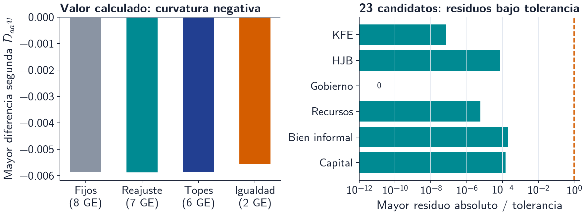

# Concavidad y equilibrio: comprobación del 26 de noviembre

La concavidad del valor calculado y los residuos de equilibrio se comprobaron hoy en MATLAB R2025b Update 2 para los 23 resultados guardados del 13 de noviembre. Todos pasaron. Un cálculo independiente en Python reprodujo las curvaturas y los residuos, comprobando además que los MAT conservan los hashes de la evidencia anterior. Esta ejecución auditó soluciones existentes; no resolvió nuevos GE ni refinó las grillas.



## Qué se calculó

Para cada productividad se calcularon pendientes entre nodos de activos, `D_a v = diff(V)/diff(a)`, y la variación de esas pendientes dividida por la distancia entre sus puntos medios, `D_aa v`. Este procedimiento admite activos no equiespaciados. También se recuperó el valor marginal usado por las políticas desde `Va = 1/(cF+pI*cI)`, con utilidad logarítmica e impuesto al consumo cero, condiciones verificadas en los archivos y bitácoras.

En las 23 grillas de 400 activos por 40 productividades, con activos entre −1 y 40:

- Todas las pendientes del valor fueron positivas y todas las diferencias segundas fueron negativas. La mayor curvatura calculada fue −0,00556519.
- El valor marginal fue positivo y disminuyó entre todos los nodos consecutivos. Su mayor incremento fue −0,000421362.
- Hubo cero violaciones de concavidad o de monotonía. El código conserva tanto los valores sin ajustar como las tolerancias; el signo estricto anterior no procede de redondearlos a cero.

Las pendientes decrecientes implican concavidad del interpolante lineal del valor calculado, para cada productividad de la grilla, hasta la precisión aritmética utilizada. No certifican el error respecto de la función de valor del modelo continuo.

## Equilibrio numérico

Se recalcularon los mercados y recursos desde las distribuciones y políticas guardadas, además de los residuos de HJB/KFE. Las tolerancias de equilibrio se conservaron del auditor anterior.

| Condición | Mayor residuo absoluto entre los 23 casos | Tolerancia |
|---|---:|---:|
| Mercado de capital | 4,52e−7 | 3e−3 |
| Bien informal | 3,95e−8 | 2e−4 |
| Recursos formales, incluidas ambas cuñas | 1,15e−8 | 2e−3 |
| Gobierno | 0 | 2e−6 |
| HJB | 7,07e−11 | 1e−6 |
| KFE | 7,42e−16 | 1e−8 |

Esto respalda los 23 candidatos de equilibrio discretizado con las tolerancias declaradas. La unicidad de la distribución estacionaria para el generador de cada candidato fue comprobada por el auditor anterior; no implica unicidad del equilibrio de precios.

## Qué faltaría para una demostración global

Después de esta auditoría se revisaron las pruebas originales del suplemento editorial de Achdou et al.: A.1, A.7, A.8, G.2 y G.3. El [cotejo detallado](revision-pruebas-achdou.md) identifica un argumento adaptable de concavidad débil a precios dados y explica por qué no basta para la curvatura estricta o para existencia y unicidad de nuestro GE. El resultado del paper conserva sus condiciones.

**Concavidad teórica.** A precios dados se puede investigar un argumento de concavidad del problema dinámico. Habría que justificar la convexidad de las trayectorias y controles admisibles, la concavidad de las preferencias, el tratamiento de la prima de deuda, la finitud del valor y las fronteras. La concavidad débil no garantiza por sí sola `Vaa < 0` ni que esa derivada exista en todos los puntos. La segunda derivada negativa del objetivo laboral tampoco demuestra la concavidad de todo el valor dinámico. El Supuesto 4 del paper se mantiene y no se modifica la proposición ya formalizada.

**Existencia teórica del GE.** Sería necesario establecer existencia de la solución individual y de la distribución estacionaria para los precios relevantes, continuidad o las propiedades adecuadas de la correspondencia de agregados, y condiciones que garanticen un precio de equilibrio. El resultado de un buscador de raíces y los residuos pequeños no constituyen ese teorema.

**Precisión al aproximar el modelo continuo.** Sigue pendiente un estudio suficiente de refinamiento y truncamiento de activos y productividad. Las [notas de Benjamin Moll sobre HJB](https://benjaminmoll.com/wp-content/uploads/2019/07/Lecture3_2149.pdf) distinguen la convergencia del algoritmo iterativo de la convergencia de la aproximación cuando se refina la grilla; presentan monotonicidad, consistencia y estabilidad como condiciones relevantes. Aquí no se verifica un teorema de convergencia para el motor completo de dos sectores.

## Reproducir y consultar las salidas

En MATLAB, con los MAT y sus bitácoras en subcarpetas de una misma carpeta:

```matlab
addpath('code/matlab');
test_value_shape_checks;
audit_saved_ge('RUTA_A_LA_CARPETA_RUNS', 'code/data/matlab_value_equilibrium_audit.json');
```

El test incluye un valor convexo que debe rechazarse, una grilla no uniforme y una función lineal para distinguir concavidad débil de curvatura estrictamente negativa.

La [salida real de MATLAB](matlab-value-equilibrium-check.txt), el [reporte por caso](../code/data/matlab_value_equilibrium_audit.json) y el [recibo con hashes](matlab-validation.json) se conservan. `python code/verify.py` comprueba esa evidencia retenida y regenera el resumen y la figura; no ejecuta MATLAB en CI. Las matrices completas del modelo permanecen locales, como en la auditoría anterior.
